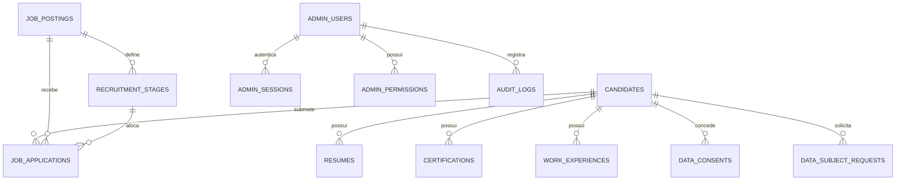

# Arquitetura e Modelagem do Banco de Dados — AJN Carreiras

## 1. Visão Geral da Arquitetura de Dados

O banco de dados relacional do portal **AJN Carreiras** foi modelado para o **Cloudflare D1** (SQLite distribuído em edge) utilizando o **Drizzle ORM** com tipagem estrita TypeScript.

A modelagem contempla 13 tabelas projetadas para garantir integridade referencial, conformidade total com a Lei Geral de Proteção de Dados (LGPD - Lei 13.709/2018), rastreabilidade de candidatos, gestão de etapas de recrutamento e governança de acessos administrativos.

---

## 2. Dicionário de Dados e Entidades

### 2.1. `candidates` (Candidatos)
Armazena as informações cadastrais dos candidatos inscritos em vagas ou no banco de talentos.
- `id` (TEXT, PK): Identificador UUIDv4 único.
- `tracking_code` (TEXT, UNIQUE): Código de rastreamento no formato `AJN-XXXXXX` (base32 human-readable) para acompanhamento sem exposição de dados sensíveis.
- `full_name` (TEXT): Nome completo do candidato.
- `email` (TEXT, UNIQUE): E-mail único de contato.
- `phone` (TEXT): Telefone de contato formatado.
- `cpf_masked` (TEXT): CPF mascarado no formato `***.XXX.XXX-**` para preservação de privacidade.
- `city` (TEXT): Município de residência.
- `state` (TEXT): Unidade federativa (ex: MG, SP).
- `linkedin_url` (TEXT): Link de perfil profissional (opcional).
- `portfolio_url` (TEXT): Link de portfólio (opcional).
- `source` (TEXT): Origem (`job_posting`, `talent_pool`, `referral`).
- `talent_pool_opt_in` (INTEGER): Booleano (1/0) de consentimento para o banco de talentos.
- `status` (TEXT): Status (`active`, `hired`, `archived`, `deleted`).
- `notes` (TEXT): Anotações do recrutador humano.
- `rating` (INTEGER): Avaliação de 1 a 5 estrelas atribuída exclusivamente por humanos.
- `created_at` (INTEGER): Timestamp epoch ms de cadastro.
- `updated_at` (INTEGER): Timestamp epoch ms de atualização.

### 2.2. `resumes` (Currículos)
Armazena metadados de anexos de currículo gravados no bucket privado Cloudflare R2. Nenhum arquivo possui URL pública.
- `id` (TEXT, PK): Identificador UUIDv4.
- `candidate_id` (TEXT, FK `candidates.id` ON DELETE CASCADE).
- `r2_key` (TEXT, UNIQUE): Chave interna do objeto no bucket privado (ex: `resumes/{candidate_id}/{uuid}.pdf`).
- `filename` (TEXT): Nome original do arquivo enviado.
- `mime_type` (TEXT): MIME validado por Magic Bytes (`application/pdf`, `application/vnd.openxmlformats-officedocument.wordprocessingml.document`).
- `file_size` (INTEGER): Tamanho do arquivo em bytes (máx 5MB).
- `sha256` (TEXT): Hash criptográfico SHA-256 para verificação de integridade.
- `is_current` (INTEGER): Booleano indicando o currículo ativo.
- `created_at` (INTEGER): Timestamp epoch ms.

### 2.3. `certifications` (Certificações e NRs)
Crítico para a atuação da AJN em Engenharia e Segurança do Trabalho (SST).
- `id` (TEXT, PK): Identificador UUIDv4.
- `candidate_id` (TEXT, FK `candidates.id` ON DELETE CASCADE).
- `name` (TEXT): Nome da certificação/treinamento (ex: NR-10, NR-35, CREA/CFT).
- `issuing_org` (TEXT): Órgão emissor.
- `issue_date` (TEXT): Data de emissão.
- `expiry_date` (TEXT): Data de validade (para controle de renovação).
- `credential_id` (TEXT): Código de validação do certificado.

### 2.4. `work_experiences` (Experiências Profissionais)
- `id` (TEXT, PK): Identificador UUIDv4.
- `candidate_id` (TEXT, FK `candidates.id` ON DELETE CASCADE).
- `company` (TEXT): Empresa anterior.
- `role` (TEXT): Cargo ocupado.
- `start_date` (TEXT): Data de início.
- `end_date` (TEXT): Data de término (nulo para emprego atual).
- `is_current` (INTEGER): Booleano de trabalho atual.
- `description` (TEXT): Descrição das atribuições.

### 2.5. `job_postings` (Vagas)
- `id` (TEXT, PK): Identificador UUIDv4.
- `slug` (TEXT, UNIQUE): Slug para URLs amigáveis e SEO (`/carreiras/{slug}`).
- `title` (TEXT): Título da vaga.
- `department` (TEXT): Departamento (Engenharia, SST, Administrativo, Comercial, TI).
- `location` (TEXT): Localidade (ex: Belo Horizonte / MG, Híbrido, Presencial).
- `employment_type` (TEXT): Regime (`full_time`, `part_time`, `contract`, `internship`).
- `experience_level` (TEXT): Nível (`estagio`, `junior`, `pleno`, `senior`, `especialista`).
- `description` (TEXT): Descrição detalhada da vaga.
- `requirements` (TEXT): Requisitos mandatórios (JSON string ou texto).
- `desirables` (TEXT): Diferenciais e requisitos desejáveis.
- `benefits` (TEXT): Benefícios oferecidos.
- `salary_range` (TEXT): Faixa salarial ou "A combinar".
- `status` (TEXT): Situação (`draft`, `published`, `paused`, `closed`).
- `published_at` (INTEGER): Timestamp epoch ms de publicação.
- `expires_at` (INTEGER): Timestamp epoch ms de encerramento das inscrições.

### 2.6. `recruitment_stages` (Etapas de Recrutamento)
Modelagem dinâmica do funil/pipeline (Kanban).
- `id` (TEXT, PK): Identificador UUIDv4.
- `job_posting_id` (TEXT, FK `job_postings.id` ON DELETE CASCADE).
- `name` (TEXT): Nome da etapa (ex: Triagem, Entrevista RH, Teste Técnico, Entrevista Diretoria, Proposta).
- `display_order` (INTEGER): Ordem de exibição no Kanban.
- `is_final_success` (INTEGER): Flag de contratação.
- `is_final_rejection` (INTEGER): Flag de reprovação.

### 2.7. `job_applications` (Candidaturas)
- `id` (TEXT, PK): Identificador UUIDv4.
- `job_posting_id` (TEXT, FK `job_postings.id` ON DELETE CASCADE).
- `candidate_id` (TEXT, FK `candidates.id` ON DELETE CASCADE).
- `current_stage_id` (TEXT, FK `recruitment_stages.id`).
- `status` (TEXT): Situação (`applied`, `in_review`, `approved`, `rejected`, `withdrawn`).
- `rejection_reason` (TEXT): Motivo formal em caso de reprovação.
- `cover_letter` (TEXT): Carta de apresentação do candidato.

### 2.8. `admin_users` (Usuários Administrativos)
- `id` (TEXT, PK): Identificador UUIDv4.
- `email` (TEXT, UNIQUE): E-mail corporativo.
- `name` (TEXT): Nome do usuário administrativo.
- `password_hash` (TEXT): Hash PBKDF2-SHA256 (100.000 iterações com salt criptográfico único).
- `password_salt` (TEXT): Salt randômico de 16 bytes em hex.
- `role` (TEXT): Papel (`superadmin`, `recruiter`, `interviewer`, `dpo`).
- `is_active` (INTEGER): Status da conta (1/0).
- `totp_secret` (TEXT): Segredo base32 para MFA TOTP (RFC 6238).
- `totp_enabled` (INTEGER): Booleano de MFA ativo.
- `failed_login_attempts` (INTEGER): Contador para bloqueio por força bruta.
- `lockout_until` (INTEGER): Timestamp epoch ms até o desbloqueio automático.

### 2.9. `admin_sessions` (Sessões Administrativas)
- `id` (TEXT, PK): Identificador UUIDv4.
- `token_hash` (TEXT, UNIQUE): Hash SHA-256 do token de sessão.
- `user_id` (TEXT, FK `admin_users.id` ON DELETE CASCADE).
- `expires_at` (INTEGER): Timestamp epoch ms de expiração da sessão (8h sliding window).
- `ip_address` (TEXT): IP de origem para verificação de sequestro de sessão.
- `user_agent` (TEXT): User-Agent do navegador.

### 2.10. `admin_permissions` (Permissões RBAC)
- `id` (TEXT, PK): Identificador UUIDv4.
- `user_id` (TEXT, FK `admin_users.id` ON DELETE CASCADE).
- `resource` (TEXT): Recurso protegido (`candidates`, `jobs`, `resumes`, `lgpd`, `audit`).
- `action` (TEXT): Ação concedida (`create`, `read`, `update`, `delete`, `export`).

### 2.11. `data_consents` (Termos de Consentimento LGPD)
Garante a conformidade com o Artigo 7º da LGPD.
- `id` (TEXT, PK): Identificador UUIDv4.
- `candidate_id` (TEXT, FK `candidates.id` ON DELETE CASCADE).
- `consent_type` (TEXT): Tipo de termo (`recruitment_process`, `talent_pool_retention`).
- `granted` (INTEGER): 1 para consentido, 0 para revogado.
- `ip_address` (TEXT): Endereço IP do titular no momento do aceite.
- `user_agent` (TEXT): Dispositivo e navegador no momento do aceite.
- `term_version` (TEXT): Versão do termo vigente (ex: `v1.0-2026`).

### 2.12. `data_subject_requests` (Solicitações do Titular - LGPD Art. 18)
- `id` (TEXT, PK): Identificador UUIDv4.
- `candidate_id` (TEXT, FK `candidates.id`).
- `request_type` (TEXT): Tipo (`access`, `rectification`, `erasure`, `portability`, `revocation`).
- `status` (TEXT): Status do atendimento (`pending`, `in_analysis`, `fulfilled`, `rejected`).
- `reason` (TEXT): Justificativa do titular.
- `response_notes` (TEXT): Parecer do DPO / Encarregado de Dados.

### 2.13. `audit_logs` (Trilhas de Auditoria Imutáveis)
- `id` (TEXT, PK): Identificador UUIDv4.
- `user_id` (TEXT): Usuário autor da ação ou `public_candidate` / `system`.
- `action` (TEXT): Ação executada (ex: `CANDIDATE_RESUME_DOWNLOAD`, `JOB_CREATE`, `LGPD_DATA_ERASURE`).
- `entity_type` (TEXT): Entidade impactada (`candidate`, `resume`, `job`, `session`).
- `entity_id` (TEXT): ID da entidade.
- `details` (TEXT): Metadados estruturados JSON.
- `ip_address` (TEXT): IP de origem da requisição.
- `user_agent` (TEXT): Agente do cliente.
- `created_at` (INTEGER): Timestamp epoch ms.

---

## 3. Índices de Otimização e Performance

Para garantir consultas rápidas na borda (Edge Cloudflare) sem lock de tabelas:
- `idx_candidates_email`: Busca rápida por duplicidade cadastral.
- `idx_candidates_tracking`: Indexação do tracking code `AJN-XXXXXX` para consulta de status.
- `idx_resumes_candidate`: Recuperação imediata de currículos de um candidato.
- `idx_job_postings_slug`: Resolução de páginas de vagas em O(1).
- `idx_job_postings_status`: Filtro de vagas publicadas vs. rascunhos.
- `idx_job_applications_stage`: Filtragem instantânea do Kanban por etapa.
- `idx_admin_sessions_token`: Resolução ultra-rápida de sessão em cada requisição autenticada.
- `idx_audit_logs_created_at`: Ordenação cronológica de auditoria e relatórios de conformidade.

---

## 4. Testes e Validação do Banco

- **Migrações:** Executadas via Drizzle-Kit (`drizzle-kit generate` e D1 migrations).
- **Integridade:** Suite `tests/db/schema.test.ts` valida relacionamentos, chaves estrangeiras com cascata de exclusão e unicidade de tracking code e e-mail.
- **Backup e Restauração:** Suite `tests/db/backup.test.ts` simula cópia online de banco SQLite e 100% de restauração íntegra de registros de auditoria e candidaturas.
