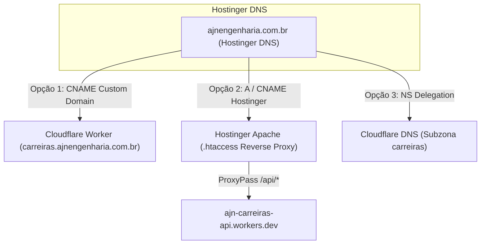

# Guia de Configuração e Implantação — AJN Carreiras

Este documento orienta a equipe de Engenharia e DevOps sobre o provisionamento de recursos, a configuração de segurança e o procedimento de deploy do backend e frontend do portal **AJN Carreiras**.

---

## 1. Topologia de Infraestrutura

- **Frontend:** Astro (SSG), servido via Hostinger Apache (`public/.htaccess`).
- **Backend API:** Cloudflare Workers (`worker/index.ts`).
- **Banco de Dados Relacional:** Cloudflare D1 (`prod-ajn-carreiras-d1`).
- **Armazenamento Privado:** Cloudflare R2 (`prod-ajn-carreiras-resumes`, privado, sem acesso público).
- **Rate Limiting Distribuído:** Cloudflare KV (`prod-ajn-carreiras-kv`).
- **Proteção Antispam:** Cloudflare Turnstile com política estrita *Fail-Secure*.

---

## 2. Nomenclatura Padronizada de Recursos

Para garantir total consistência entre o código (`worker/wrangler.toml`), pipelines de CI/CD e este guia, utilize rigorosamente os seguintes nomes:

| Recurso | Ambiente de Produção | Ambiente de Staging / Homologação |
|---|---|---|
| **Worker API** | `ajn-carreiras-api` | `ajn-carreiras-api-staging` |
| **Banco D1** | `prod-ajn-carreiras-d1` | `staging-ajn-carreiras-d1` |
| **Bucket R2** | `prod-ajn-carreiras-resumes` | `staging-ajn-carreiras-resumes` |
| **Namespace KV** | `prod-ajn-carreiras-kv` | `staging-ajn-carreiras-kv` |

---

## 3. Provisionamento dos Recursos na Cloudflare

Execute os comandos abaixo a partir de um terminal autenticado no Wrangler (`npx wrangler login`):

### 3.1. Criar os Bancos de Dados D1
```bash
# Produção
npx wrangler d1 create prod-ajn-carreiras-d1

# Staging
npx wrangler d1 create staging-ajn-carreiras-d1
```
*Copie os `database_id` gerados e atualize os campos correspondentes no arquivo `worker/wrangler.toml`.*

### 3.2. Criar os Buckets Privados R2
```bash
# Produção
npx wrangler r2 bucket create prod-ajn-carreiras-resumes

# Staging
npx wrangler r2 bucket create staging-ajn-carreiras-resumes
```
> [!CAUTION]
> **NUNCA** ative a opção "Public Access" ou vincule domínios públicos diretamente aos buckets R2. O acesso aos arquivos de currículos é estritamente mediado pelo Cloudflare Worker através de verificação de permissão RBAC (`resumes:read`) e trilha de auditoria imutável.

### 3.3. Criar os Namespaces KV para Rate Limiting Distribuído
```bash
# Produção
npx wrangler kv:namespace create prod-ajn-carreiras-kv

# Staging
npx wrangler kv:namespace create staging-ajn-carreiras-kv
```
*Atualize as chaves `id` no bloco `[[kv_namespaces]]` em `worker/wrangler.toml`.*

### 3.4. Configurar Segredos Obrigatórios (Fail-Secure)
No diretório `worker/`:
```bash
# Segredo criptográfico de sessão
npx wrangler secret put SESSION_SECRET

# Segredo obrigatório do Cloudflare Turnstile (Fail-Secure em staging/prod)
npx wrangler secret put TURNSTILE_SECRET_KEY
```

---

## 4. Migrações e Bootstrap do Usuário Inicial

### 4.1. Aplicar Migração SQL no D1
```bash
# Ambiente local (testes locais)
npx wrangler d1 execute prod-ajn-carreiras-d1 --local --file=./worker/db/migrations/0000_curious_the_executioner.sql

# Ambiente de Staging remoto
npx wrangler d1 execute staging-ajn-carreiras-d1 --remote --file=./worker/db/migrations/0000_curious_the_executioner.sql

# Ambiente de Produção remoto
npx wrangler d1 execute prod-ajn-carreiras-d1 --remote --file=./worker/db/migrations/0000_curious_the_executioner.sql
```

### 4.2. Criar Acesso Administrativo Inicial (Seed com MFA Obrigatório)
O script `worker/db/seed.ts` possui execução CLI segura e reproduzível:
```bash
ADMIN_EMAIL="rh@ajnengenharia.com.br" ADMIN_PASSWORD="<SENHA_FORTE_MINIMO_8_CHARS>" npx tsx worker/db/seed.ts
```
O comando gerará o segredo TOTP e a URI `otpauth://` para configuração no aplicativo autenticador (Google Authenticator ou Microsoft Authenticator).

---

## 5. Viabilidade e Topologias de Roteamento com Hostinger DNS

Considerando que o domínio institucional `ajnengenharia.com.br` utiliza hospedagem e servidores de DNS da **Hostinger**, foram avaliadas quatro topologias para o subdomínio `carreiras.ajnengenharia.com.br`:



### Topologia 1 (Recomendada): Custom Domain de Worker via CNAME na Hostinger
1. No painel Cloudflare Workers, em `ajn-carreiras-api` > **Settings** > **Triggers** > **Custom Domains**, adicione `carreiras.ajnengenharia.com.br`.
2. No painel de DNS da Hostinger (hPanel):
   - Adicione registro: **Tipo:** `CNAME` | **Nome:** `carreiras` | **Aponta para:** `ajn-carreiras-api.workers.dev` (ou o hostname fornecido pela Cloudflare).
3. A Cloudflare valida a titularidade e emite o certificado SSL automaticamente (via Cloudflare for SaaS/Custom Domains).

### Topologia 2: Subdomínio na Hostinger com Proxy Reverso Apache
1. Crie o subdomínio `carreiras.ajnengenharia.com.br` diretamente no hPanel da Hostinger, apontando para o diretório de build estático do Astro.
2. No arquivo `.htaccess` do subdomínio, adicione o encaminhamento transparente da API:
   ```apache
   RewriteEngine On
   RewriteRule ^api/(.*)$ https://ajn-carreiras-api.workers.dev/api/$1 [P,L]
   ```
3. O frontend estático é servido localmente pela Hostinger, enquanto todas as chamadas `/api/*` operam no Cloudflare Worker de forma transparente.

### Topologia 3: Delegação de Subdomínio via NS na Hostinger
1. No painel da Hostinger, adicione registros NS específicos para o subdomínio:
   - `carreiras.ajnengenharia.com.br` NS `ns1.cloudflare.com`
   - `carreiras.ajnengenharia.com.br` NS `ns2.cloudflare.com`
2. Isso concede autoridade DNS à Cloudflare exclusivamente para o subdomínio `carreiras`, preservando a apex `ajnengenharia.com.br` e o e-mail corporativo intactos na Hostinger.

### Topologia 4: Delegação Completa de DNS para a Cloudflare
1. Altere os nameservers autoritativos do domínio na entidade registradora para a Cloudflare.
2. Crie registro `A` na Cloudflare apontando para o endereço IP do servidor Hostinger (garantindo que o site institucional existente continue sendo servido sem qualquer impacto).
3. Ative a rota de Worker `carreiras.ajnengenharia.com.br/*`.

---

## 6. Procedimento de Build e Deploy

```bash
# 1. Checagem de tipos estrita
npm run check

# 2. Build estático Astro
npm run build

# 3. Testes unitários, segurança e integridade
npm run test:backend

# 4. Pipeline institucional completo de homologação
npm run validate

# 5. Deploy do Worker para o ambiente desejado
npx wrangler deploy --env staging
# ou
npx wrangler deploy --env production
```
