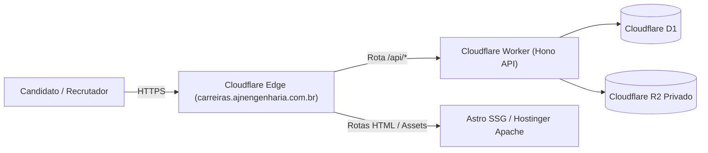

# Guia de Configuração e Deploy — AJN Carreiras

Este documento orienta a equipe de DevOps e Engenharia sobre a configuração dos recursos na Cloudflare e o procedimento de deploy do backend e do frontend.

---

## 1. Topologia de Infraestrutura

- **Frontend:** Astro (geração estática SSG), servido pelo provedor de hospedagem principal (Hostinger Apache com regras de segurança no `.htaccess`).
- **Backend API:** Cloudflare Workers (`worker/index.ts`).
- **Banco de Dados:** Cloudflare D1 (`prod-ajn-carreiras-d1`).
- **Armazenamento de Arquivos:** Cloudflare R2 (`prod-ajn-carreiras-resumes`, privado, sem acesso público).
- **Proteção:** Cloudflare Turnstile e Cloudflare WAF / Rate Limiting.

---

## 2. Pré-requisitos

1. Conta ativa na [Cloudflare](https://dash.cloudflare.com/).
2. Wrangler CLI instalado globalmente ou via `npx wrangler`.
3. Node.js v20+ e npm.

---

## 3. Provisionamento dos Recursos na Cloudflare

Execute os seguintes comandos via terminal autenticado no Wrangler (`wrangler login`):

### 3.1. Criar o Banco D1
```bash
# Produção
npx wrangler d1 create prod-ajn-carreiras-d1

# Staging / Homologação
npx wrangler d1 create staging-ajn-carreiras-d1
```
*Anote o `database_id` gerado e preencha no arquivo `worker/wrangler.toml`.*

### 3.2. Criar o Bucket Privado R2
```bash
# Produção
npx wrangler r2 bucket create prod-ajn-carreiras-resumes

# Staging / Homologação
npx wrangler r2 bucket create staging-ajn-carreiras-resumes
```
> [!IMPORTANT]
> **NUNCA** ative o recurso "Public Access" ou "Custom Domain" no bucket R2 criado. O acesso a currículos deve ocorrer exclusivamente mediado pelo Worker autenticado.

### 3.3. Configurar Segredos e Variáveis de Ambiente no Worker
No diretório `worker/`:
```bash
# Segredo para assinatura de sessões e HMAC
npx wrangler secret put SESSION_SECRET

# Chave secreta do Cloudflare Turnstile
npx wrangler secret put TURNSTILE_SECRET_KEY
```

As variáveis de ambiente não sensíveis são configuradas no `worker/wrangler.toml`:
- `ENVIRONMENT = "production"`
- `CORS_ORIGIN = "https://ajnengenharia.com.br"`
- `TURNSTILE_SITE_KEY = "0x4AAAAAA..."`

---

## 4. Execução de Migrations e Seed Inicial

### 4.1. Aplicar Migrations no Banco D1
```bash
# Em ambiente local (para testes)
npx wrangler d1 execute prod-ajn-carreiras-d1 --local --file=./worker/db/migrations/0000_curious_the_executioner.sql

# Em ambiente de homologação/produção remoto
npx wrangler d1 execute staging-ajn-carreiras-d1 --remote --file=./worker/db/migrations/0000_curious_the_executioner.sql
npx wrangler d1 execute prod-ajn-carreiras-d1 --remote --file=./worker/db/migrations/0000_curious_the_executioner.sql
```

### 4.2. Criar Usuário Administrador Inicial (Seed)
Execute o script de seed passando a variável com senha segura:
```bash
ADMIN_EMAIL="rh@ajnengenharia.com.br" ADMIN_PASSWORD="<SENHA_FORTE_GERADA>" npx tsx worker/db/seed.ts
```

---

## 5. Deploy do Backend (Worker)

No diretório do projeto:
```bash
# Deploy para ambiente de staging
npx wrangler deploy --env staging

# Deploy para produção
npx wrangler deploy --env production
```

### 5.1. Arquitetura do Subdomínio `carreiras.ajnengenharia.com.br`

O subdomínio dedicado `carreiras.ajnengenharia.com.br` foi arquitetado segundo o padrão **Edge Unified Reverse Proxy**:



1. **Configuração de DNS (Cloudflare):**
   - Registro CNAME: `carreiras.ajnengenharia.com.br` apontando para o servidor de origem Hostinger (ou Cloudflare Pages/Edge com proxy ativado - Nuvem Laranja).
2. **Roteamento de Worker (Cloudflare Route):**
   - Regra de Rota: `carreiras.ajnengenharia.com.br/api/*` vinculada ao Worker `ajn-carreiras-api`.
   - **Vantagem de Performance e Segurança:** As chamadas de API executam na mesma origem (`same-origin`), dispensando preflights CORS e garantindo cookies de sessão `SameSite=Strict; Secure; HttpOnly`.
3. **Descoberta Institucional:**
   - O domínio institucional `https://ajnengenharia.com.br/carreiras/` redireciona via HTTP 301 ou espelha o conteúdo de `https://carreiras.ajnengenharia.com.br/`, mantendo a autoridade de domínio e SEO.

---

## 6. Build e Deploy do Frontend

O frontend é construído de forma 100% estática via Astro, garantindo compatibilidade total com os gates de validação da AJN:
```bash
# 1. Checagem de tipos
npm run check

# 2. Build estático
npm run build

# 3. Testes de qualidade e segurança
npm run validate
```

Os arquivos gerados no diretório `dist/` são transferidos para o servidor Apache Hostinger. O arquivo `public/.htaccess` existente garante que as novas rotas (`/carreiras/`, `/carreiras/talentos/`, `/carreiras/acompanhamento/` e `/admin/carreiras/`) sejam servidas com cabeçalhos de segurança rígidos (CSP, HSTS, X-Content-Type-Options).
